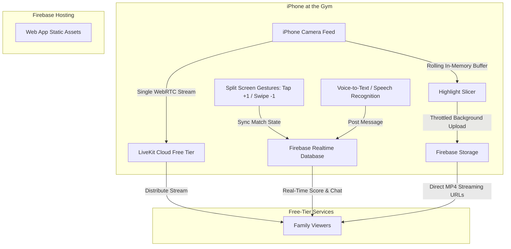

# GameStreamer: Volleyball Live Streaming, Scoring & Highlight Hub

## 1. Project Overview & Objectives
**GameStreamer** is a web application designed to live stream youth volleyball games from an iPhone (mounted on a tripod or handheld) to 1–4 remote family members over cellular data or gym Wi-Fi, while providing live scorekeeping, family cheering, and an instant highlight clipping archive.

### Core Objectives
1. **Zero Operating Cost**: Built entirely on free-tier infrastructure ($0/month, no monthly bills).
2. **Single Permanent Family Hub**: One bookmarkable URL (`gamestreamer.web.app`) for family. Auto-detects when a match is live, and presents a uniform match and highlight archive.
3. **Cellular-Optimized Video**: Single upload stream from iPhone to cloud relay (LiveKit Free Tier), keeping the phone cool and conserving mobile data.
4. **Sub-Second Latency**: Real-time WebRTC stream (<500ms delay) so family reacts to plays as they happen.
5. **Maximized Viewport & Invisible Split Gestures**:
   - Camera preview fills 100% of the screen.
   - Left half of the screen controls Left Team score; Right half controls Right Team score.
   - **Tap = +1**, **Swipe Down = -1**.
   - Bottom row: `US <score1>` (left), `[⇄ Swap]` (center midline), `THEM <score2>` (right).
   - Top row: `🔴 LIVE (<viewers>)` (top-left), `SET <num>` (top-center), `[⚡ HIGHLIGHT]` (top-right).
6. **Non-Obstructive Expandable Chat**:
   - **Viewers**: Expandable sidebar that resizes/shrinks the video view so the chat never covers the court footage.
   - **Streamer**: Space-efficient hideable chat sidebar with **Voice-to-Text (`🎙️`)** dictation to post comments without triggering the iOS virtual keyboard over the camera feed.
7. **Unified Match & Highlight Archive**:
   - All clips (live in-progress and past games) live uniformly in the Match Archive list.
   - Includes `⏳ Uploading...` status indicators for clips actively transferring over the background buffer.
8. **Interactive Replay Player**: Viewers can review clips with play/pause, seek, and always-visible toggle buttons for `1x`, `0.5x`, and `0.25x` speed (defaulting to `1x`).
9. **Apple-Grade Minimalist Aesthetics**: Refined, distraction-free UI using frosted glass (`backdrop-filter: blur`), SF Pro system typography, tabular numerals, muted dark OLED tones, and fluid iOS-style tactile spring animations.
10. **PWA (Progressive Web App)**: Installable to the iPhone Home Screen for a clean, full-screen camera experience without Safari address bar clutter.

---

## 2. Design System & Aesthetics (Apple-Inspired Minimalism)

- **Typography**:
  - System font stack (`-apple-system, BlinkMacSystemFont, "SF Pro Display", "SF Pro Text", sans-serif`).
  - Score counters use `font-variant-numeric: tabular-nums` to prevent layout jitter when numbers change.
  - High typographic hierarchy: subtle uppercase tracking for labels (`SET 1`, `LIVE`), ultra-clean bold figures for scores.
- **Materials & Surfaces**:
  - **Ultra-Thin Frosted Glass**: `backdrop-filter: blur(24px) saturate(180%)` with soft translucent backgrounds (`rgba(255, 255, 255, 0.08)` dark mode / `rgba(0, 0, 0, 0.45)` overlay mode).
  - **Subtle Borders**: 1px micro-borders (`rgba(255, 255, 255, 0.12)`) and continuous smooth squircles (`border-radius: 16px` to `9999px` pill shapes).
- **Color Palette**:
  - **Base Canvas**: Deep OLED Black (`#000000`) and refined Dark Zinc (`#111113`) for high battery efficiency and focus on video.
  - **Live Indicator**: Apple System Red (`#FF3B30`) with a soft pulsing glow.
  - **Active State / Toggles**: Subtle Apple White-fill (`#FFFFFF`) with contrasting dark text for depressed segmented controls.
  - **Accents**: Apple System Yellow/Gold (`#FFD60A`) for highlight triggers.
- **Motion & Micro-Interactions**:
  - Fluid spring curves: `cubic-bezier(0.16, 1, 0.3, 1)`.
  - Active press response: `transform: scale(0.96)` for instant tactile feedback.
  - Zero clutter: all chrome fades or tucks away smoothly when not in active use.

---

## 3. Main Page Layout (`/`) & Unified Archive

```
┌────────────────────────────────────────────────────────┐
│ 🏐 Game Streamer                      [🎥 Go Live]     │
├────────────────────────────────────────────────────────┤
│                                                        │
│  🔴 LIVE NOW (Displayed only when active)              │
│  ┌──────────────────────────────────────────────────┐  │
│  │  vs. Lincoln High • Set 2 (18 - 16) • Sets: 1 - 0│  │
│  │                                                  │  │
│  │            [ ▶ Tap to Watch Live Game ]          │  │
│  └──────────────────────────────────────────────────┘  │
│                                                        │
│  📁 MATCH ARCHIVE                                      │
│                                                        │
│  ▼ 🔴 Today vs. Lincoln High [In Progress]     3 Clips │
│  │  • Set 1 (14 - 12)  "Ace serve"               [▶]   │
│  │  • Set 1 (24 - 23)  "Set point block"         [▶]   │
│  │  • Set 2 (18 - 16)  "Rally dig & kill" [⏳ Uploading]│
│  │                                                     │
│  ► 📅 Oct 18, 2026 vs. West High      [Won 2-1] 6 Clips│
│  ► 📅 Oct 11, 2026 vs. East High      [Won 2-0] 4 Clips│
└────────────────────────────────────────────────────────┘
```

### Broadcaster vs. Viewer Access
- **Viewers (Family)**: **Zero Logins, Zero Barriers**. They simply open the permanent link, tap "Watch Live" (or browse past highlights), and enjoy.
- **Broadcaster (You)**: Tapping **`[🎥 Go Live]`** triggers **direct Google Sign-In / Passkey verification** automatically. There are no PINs or extra menus. Once recognized, it prompts for the Opponent name and drops you right into camera streaming mode.

### Highlights Organization
1. **Match Level (Top Level)**:
   - Formatted as `<Date> vs. <Opponent>` (e.g., `Today vs. Lincoln High [In Progress]` or `Oct 18 vs. West High [Won 2-1]`).
   - Displays final sets or live set progress.
2. **Highlight Items (Chronological Flat List)**:
   - Slices are listed by **Set & Points + Comment**:  
     `Set 1 (14 - 12) "Ace serve" [▶ Play]`
   - **Buffering / Upload State**:
     - `⏳ Uploading...`: Displayed while the background throttled uploader is actively streaming the 3–5 MB clip to storage.
     - `[▶ Play]`: Once complete, enables the slow-mo replay player.

---

## 3. Streamer Interface Layout & Touch Zones

```
┌────────────────────────────────────────────────────────┐
│ 🔴 LIVE (3)                 [ SET 1 ]     [⚡ HIGHLIGHT]│
│                                                        │
│                    VERTICAL MIDLINE                    │
│                           ┆                            │
│      LEFT HALF SCREEN     ┆     RIGHT HALF SCREEN      │
│      -----------------    ┆     ------------------     │
│      Tap:        +1       ┆     Tap:        +1         │
│      Swipe Down: -1       ┆     Swipe Down: -1         │
│                           ┆                            │
│ [US  18]                  [⇄]                [THEM 16] │
└────────────────────────────────────────────────────────┘
```

- **Top Row**:
  - `🔴 LIVE (3)` — status and viewer count.
  - `[ SET 1 ]` — tap to advance set (resets score to `0 - 0`, logs set winner). Automatically detects mathematical set victory (25 pts with 2-pt lead for Sets 1-2, or 15 pts in Set 3+) and pulses with a **glowing gold ring** (`SET 1 ★`). Advancing the set automatically logs the final set score into the chat stream!
  - `[⚡ HIGHLIGHT]` — opens pill picker to save and label clip with chosen comment.
- **Bottom Row**:
  - `<score> US` (left corner), `[⇄]` Swap button (pinned strictly to center midline), `<OPPONENT> <score>` (right corner).
- **Primary Viewing Region**:
  - Entire left half controls left score (Tap +1, Swipe Down -1).
  - Entire right half controls right score (Tap +1, Swipe Down -1).

---

## 4. Non-Obstructive Live Chat & Voice-to-Text

### A. Viewer Chat (Auto-Resizing Sidebar)
- A `[💬 Chat]` toggle button in the viewer navigation.
- **Layout Behavior**: When the sidebar is opened, the video container dynamically resizes down (maintaining 16:9 ratio) and the chat docks on the side. The video is **never obstructed or covered** by comment bubbles while family is reading or typing.

### B. Streamer Chat & Quick Cheer Drawer
- **Expandable `(+)` Cheer Drawer**:
  - A discreet `(+)` button opens a floating shelf of 1-tap cheer pills:
    - ⛏️ **Amazing Dig**
    - 💣 **Crazy Kill**
    - 🔥 **Ace!**
    - 💪 **Big Block!**
    - 🎯 **Cool Set**
  - Tapping a pill sends the comment with attached game metadata (`set`, `scoreUs`, `scoreThem`, `timestamp`).
- **Highlight Title Binding & Optional Fallback**:
  - **100% Optional**: Broadcasters do **not** need to pick a cheer pill for every highlight. 
  - If a cheer pill was tapped during the rally, it auto-appends (e.g. `Set 1 (14 - 12) - 💣 Crazy Kill`).
  - If no cheer was used, it automatically defaults cleanly to `Set 1 (14 - 12) - Highlight` with zero interruption, zero prompt popups, and no required input.
- **Failsafe Rally Buffer**:
  - If the streamer taps the score (`+1`) *before* hitting `[⚡ HIGHLIGHT]`, the buffer retains the previous rally for a 15-second grace window so the highlight is never lost.
- **Voice-to-Text (`🎙️`)**:
  - Tapping the microphone button activates the browser's speech recognition (`webkitSpeechRecognition`).
  - You speak your comment (e.g. *"Great kill by Jackson!"*), which auto-transcribes and sends.
  - **No virtual keyboard pops up**, leaving 100% of the camera feed completely visible.
- **Standard Keyboard Input**: Available if you choose to tap the text box directly.

---

## 5. Architecture & Technology Stack



### Component Details
| Layer | Tech Selection | Free-Tier Specs & Rationale |
| :--- | :--- | :--- |
| **Video Engine** | **LiveKit Cloud (Free Tier)** | 100 GB egress/month free. iPhone sends **1 upload stream**; cloud relays to 1–4 viewers. Ultra-low latency WebRTC (~200–400ms). |
| **State, Chat & Match Database** | **Firebase Realtime Database (RTDB)** | Spark Plan (Free): 100 concurrent connections, sub-100ms sync for scores, game clock, comments, and highlight metadata. |
| **Highlight Storage** | **Firebase Storage** | Spark Plan (Free): 5 GB free storage (~1,000–1,500 clips). Direct HTTPS video URLs. |
| **Web App Hosting** | **Firebase Hosting** | Spark Plan (Free): Fast global CDN, SSL, custom domain support, 10 GB storage, 360 MB/day transfer. |
| **Speech Recognition** | **Web Speech API (`webkitSpeechRecognition`)** | Built into iOS Safari. 0 external dependencies or costs. |
| **Highlight Engine** | **Client-Side `MediaRecorder` API** | Runs locally in iPhone Safari memory. 0 cloud compute cost. Background async upload avoids cellular stream stutter. |
| **Frontend Framework** | **Vite + Vanilla JS / Modern ES Modules** | Lightweight, zero-bloat, instantaneous load times even over poor gym mobile signals. |

---

## 6. Implementation Roadmap

### Phase 1: Project Scaffolding & Realtime Sync
- [ ] Initialize project with Vite and Firebase SDK.
- [ ] Set up Firebase RTDB connection and schema for match state, highlights, and chat.
- [ ] Build responsive layout:
  - Permanent Hub (`/`) with Live status card & unified Match Archive list with upload indicators.
  - Streamer View (`/stream`) with full-screen camera viewport, top controls, bottom score row, and left/right split gesture zones.
  - Viewer View (`/watch`) with video player, non-obstructive chat sidebar (video shrink), and score overlay.

### Phase 2: Live Video Streaming Engine
- [ ] Integrate LiveKit client SDK for WebRTC.
- [ ] Implement Streamer camera capture (`navigator.mediaDevices.getUserMedia`) with back-camera preference and 720p constraints.
- [ ] Integrate Screen Wake Lock API (`navigator.wakeLock`).
- [ ] Implement Viewer WebRTC video player with automatic reconnection handling.

### Phase 3: Split-Screen Gesture Scoreboard & Live Chat with Voice
- [ ] Implement left/right half-screen touch handling (Tap = +1, Swipe Down = -1) with `touch-action: none`.
- [ ] Implement midline bottom `[⇄]` swap button.
- [ ] Implement Set advance logic and reset.
- [ ] Add distinct haptic vibrations for +1 vs -1 gestures.
- [ ] Implement expandable chat sidebar with responsive video resizing.
- [ ] Implement streamer Voice-to-Text dictation using `webkitSpeechRecognition` to avoid iOS keyboard popups.

### Phase 4: Retrospective Highlight Clipping & Replay Player
- [ ] Implement in-memory rolling `MediaRecorder` chunk ring-buffer on the streamer device.
- [ ] Wire point-change timestamps to slice markers.
- [ ] Implement throttled background uploader to Firebase Storage with status reporting (`⏳ Uploading` -> `[▶ Play]`).
- [ ] Build the dedicated Replay Popover Player with `1x`/`0.5x`/`0.25x` toggles (default `1x`).

### Phase 5: PWA & Performance Polish
- [ ] Add Web App Manifest and Apple Touch Icons for "Add to Home Screen" full-screen support.
- [ ] Test network degradation and recovery (simulating spotty gym cell service).
- [ ] Deploy to Firebase Hosting.
